# 📚 ESPRIM Virtual Library

> Plateforme web sécurisée de gestion documentaire pour les rapports de **Projet de Fin d'Études (PFE)** de l'École Supérieure Privée d'Ingénieurs de Monastir (ESPRIM).


---

## 📖 Présentation

**ESPRIM Virtual Library** centralise tout le cycle de vie d'un rapport de PFE :

- l'**étudiant** soumet son rapport via un formulaire guidé en 3 étapes ;
- l'**enseignant encadrant** le relit, le commente et le valide à l'aide d'une checklist ;
- les rapports validés alimentent une **bibliothèque** consultable par la communauté.

## ✨ Fonctionnalités

### 🔐 Authentification
- Connexion avec l'adresse email institutionnelle
- Création automatique du profil à la première connexion
- **Authentification à deux facteurs (2FA / TOTP)** obligatoire pour les enseignants (Google Authenticator, Microsoft Authenticator, Authy…)
- Gestion multi-rôles (étudiant, enseignant)

### 🎓 Espace étudiant
- Soumission de rapport en 3 étapes : métadonnées → fichier → vérification
- Sauvegarde automatique toutes les 2 minutes, brouillons conservés 30 jours
- Dépôt de fichier PDF par glisser-déposer (50 Mo max)
- Checklist de vérification finale avant soumission
- Choix de la visibilité : consultation publique ou rapport confidentiel

### 👨‍🏫 Espace enseignant
- Tableau de bord avec statistiques (assignés, en attente, validés, rejetés)
- Notifications pour les nouveaux rapports à valider
- Visionneuse PDF intégrée
- Liste de validation détaillée (standards académiques, mise en forme, qualité du contenu)
- Commentaires typés : commentaire, révision requise, approbation, note interne
- Actions : **valider**, **demander une révision** ou **rejeter**, avec notification de l'étudiant par email

### 🏛️ Bibliothèque
- Catalogue des rapports validés
- Recherche par titre, mots-clés, auteur ou résumé
- Filtres avancés et tri
- Favoris, partage, compteurs de vues et de téléchargements

---

## 📸 Aperçu de l'application

### Connexion

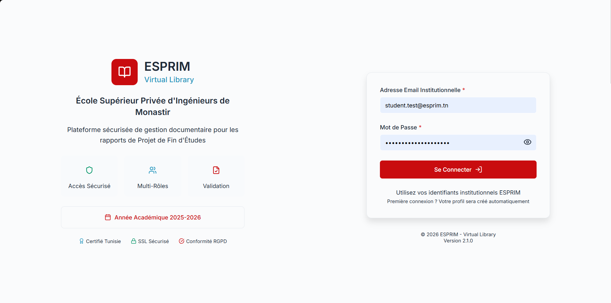

### Authentification à deux facteurs (enseignants)

| Vérification du code | Configuration de l'authentificateur |
|:---:|:---:|
| 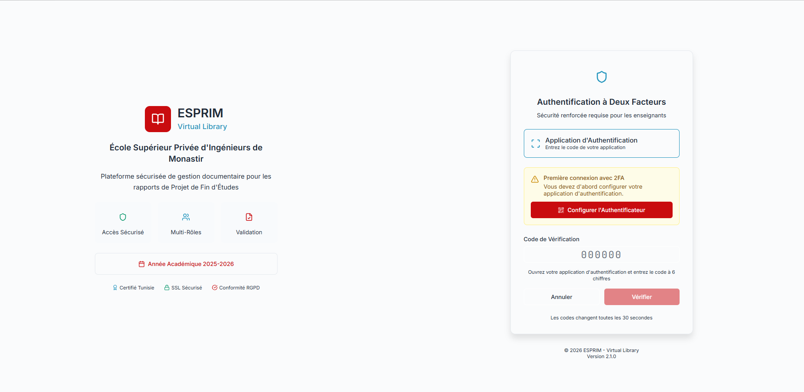 | 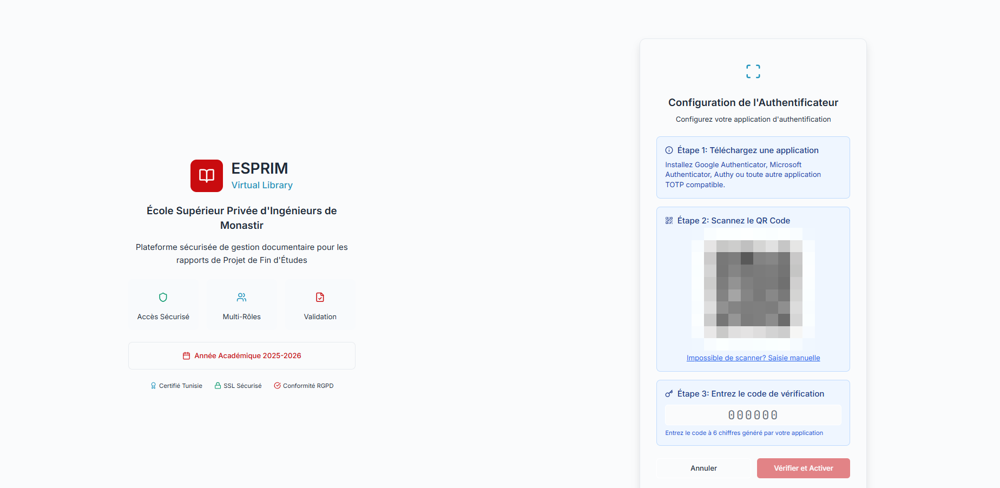 |

### Espace enseignant

**Tableau de bord**

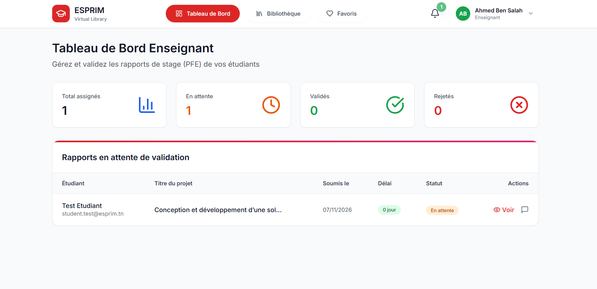

**Notifications et visionneuse PDF**

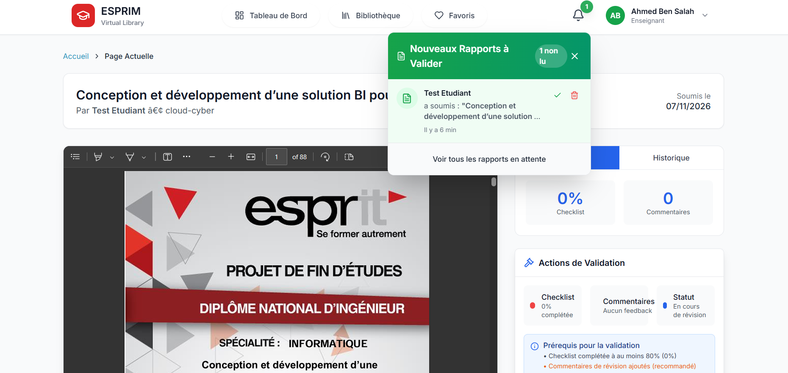

**Checklist de validation et commentaires**

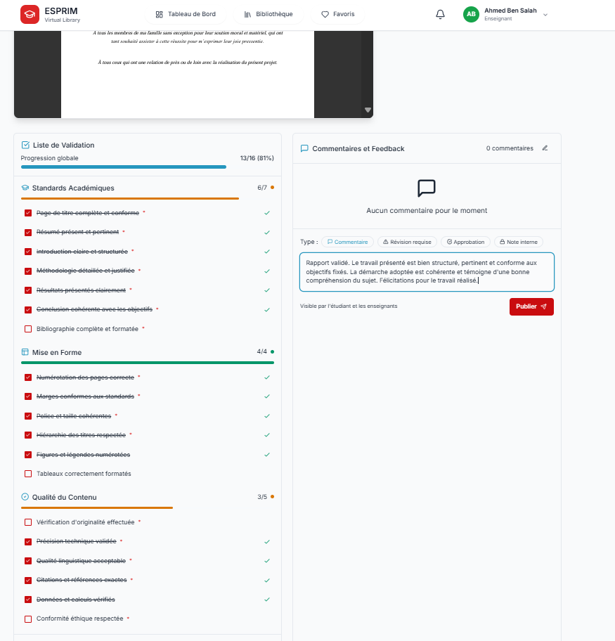

**Validation d'un rapport**

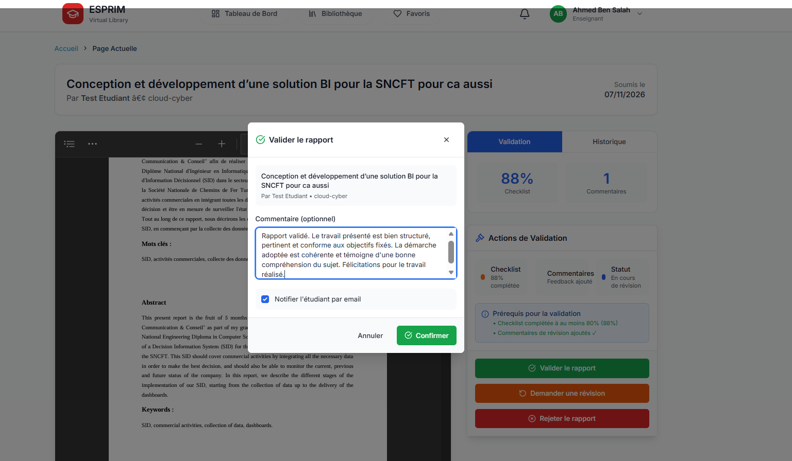

### Bibliothèque

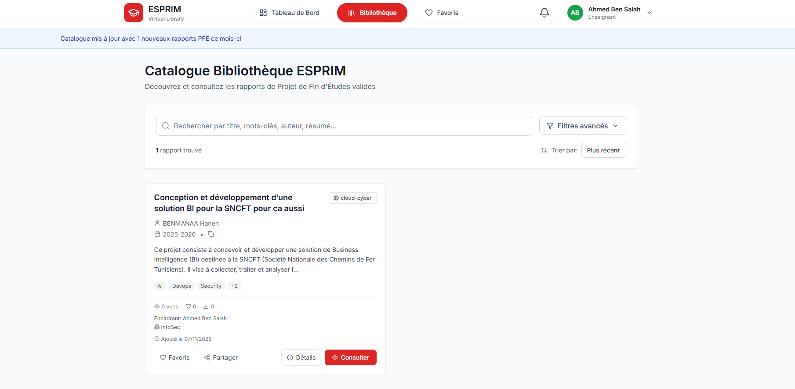

### Espace étudiant : soumission d'un rapport

**Étape 1 : Métadonnées**

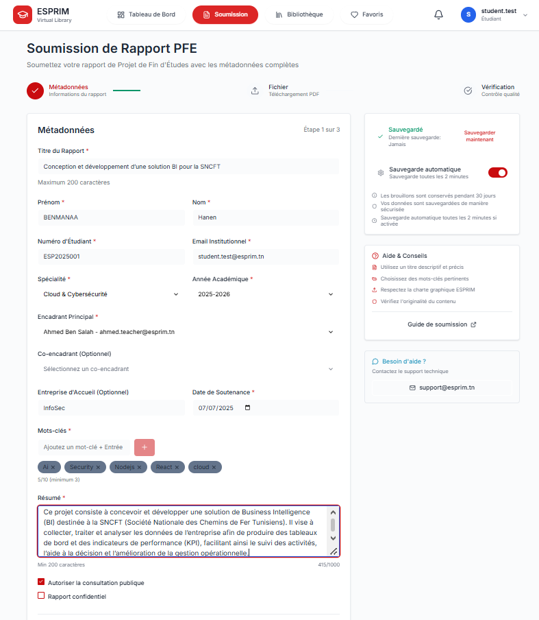

**Étape 2 : Fichier**

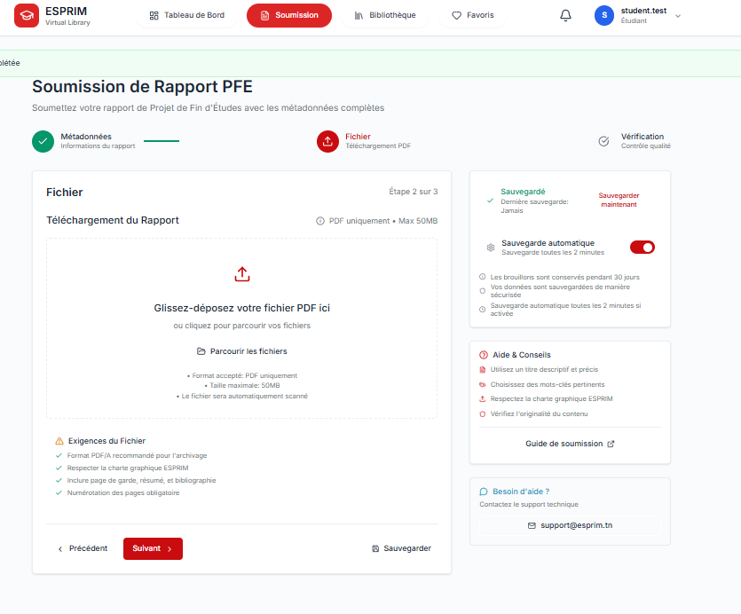

**Étape 3 : Vérification**

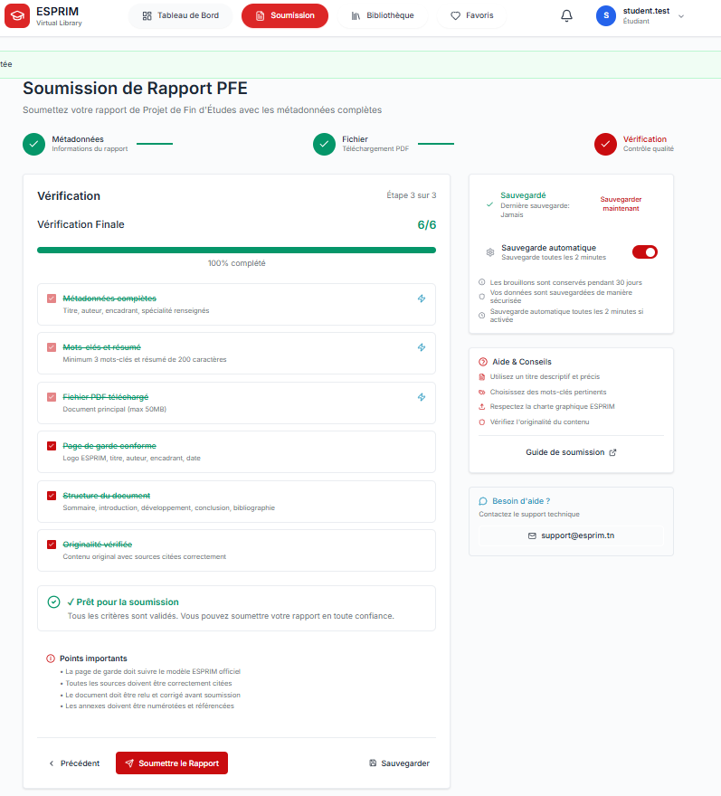

---

## 🛠️ Technologies

<!-- À COMPLÉTER avec ta stack réelle -->

| Couche | Technologie |
|---|---|
| Frontend | _à compléter_ |
| Backend | _à compléter_ |
| Base de données | _à compléter_ |
| Authentification | JWT + 2FA TOTP _(à confirmer)_ |

## 🚀 Installation

<!-- À ADAPTER à ton projet -->

```bash
# 1. Cloner le dépôt
git clone https://github.com/<ton-utilisateur>/<ton-depot>.git
cd <ton-depot>

# 2. Installer les dépendances
npm install

# 3. Configurer l'environnement
cp .env.example .env

# 4. Lancer l'application
npm run dev
```

## 📁 Structure du projet

```
.
├── docs/
│   └── screenshots/   # Captures d'écran du README
├── src/               # Code source
└── README.md
```

## 👤 Auteur

**<Ton nom>**, ESPRIM, année académique 2025-2026
[GitHub](https://github.com/<ton-utilisateur>) · [LinkedIn](https://linkedin.com/in/<ton-profil>)

## 📄 Licence

À définir (par exemple MIT).
